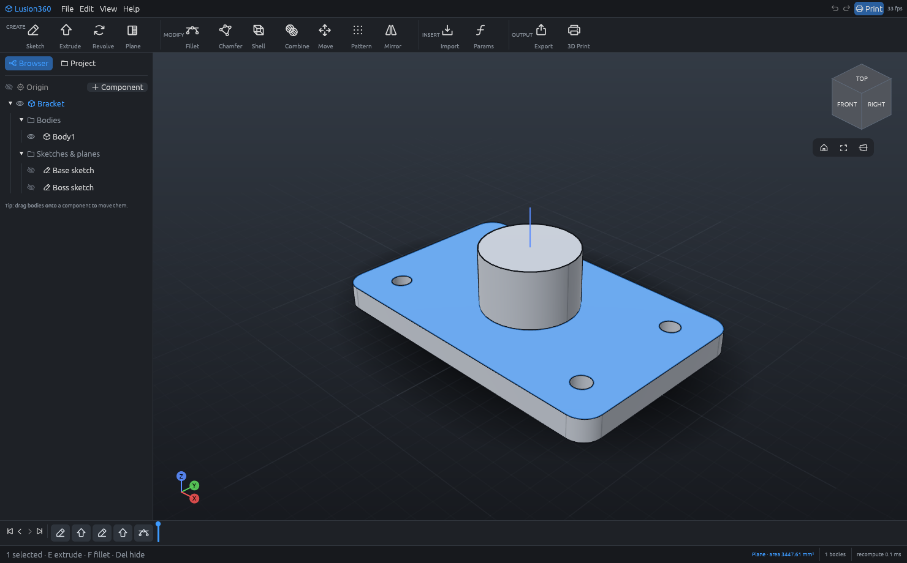

# Lusion360

A parametric CAD app for Linux, written in Rust. It follows the Fusion 360
workflow for 3D-printed parts: sketch, constrain, extrude, fillet, then change
a dimension later and have everything update.

It runs locally. Designs are plain `.l360` files you can keep in git.



## What it does

- Constrained sketches on planes or faces, with a timeline you can roll back and edit
- Extrude, revolve, sweep, loft, fillet, chamfer, shell, holes, printable threads, patterns, mirror, split
- Components and simple joints for assemblies
- Opens STEP, STL, 3MF, OBJ and more; exports STEP/STL/3MF
- Sends parts straight to Bambu Studio or another slicer, or drag a part out of the window onto it
- Turns photos of a real object into a printable mesh (via COLMAP and OpenMVS)

The geometry kernel is OpenCASCADE, behind a small C++ shim.

## Building

```bash
sudo apt install build-essential libgtk-3-dev
cargo build --release
./target/release/lusion360
```

The first build downloads a prebuilt OpenCASCADE (~70 MB). Set `OCCT_ROOT` to
use your own.

To install it with a desktop launcher, build a .deb:

```bash
tools/package-deb.sh
sudo apt install ./target/deb/lusion360_*_amd64.deb
```

There's also an MCP server (`lusion-mcp`) so agents can build models.

## License

MIT or Apache-2.0. OpenCASCADE is LGPL-2.1 with exception.
